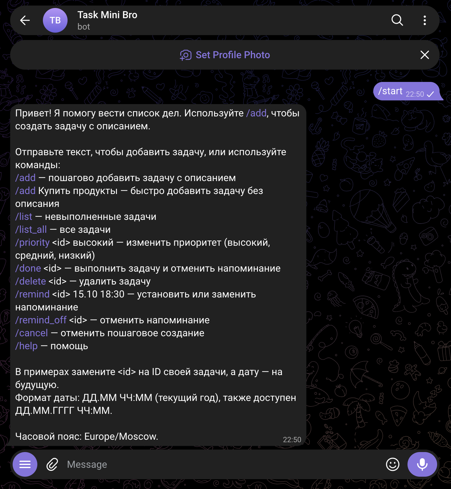
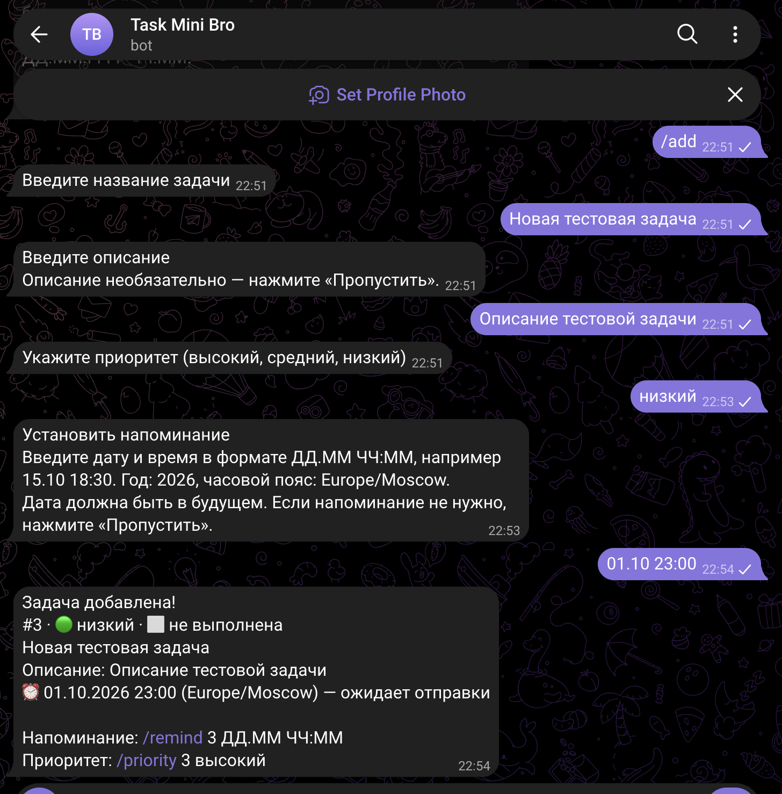
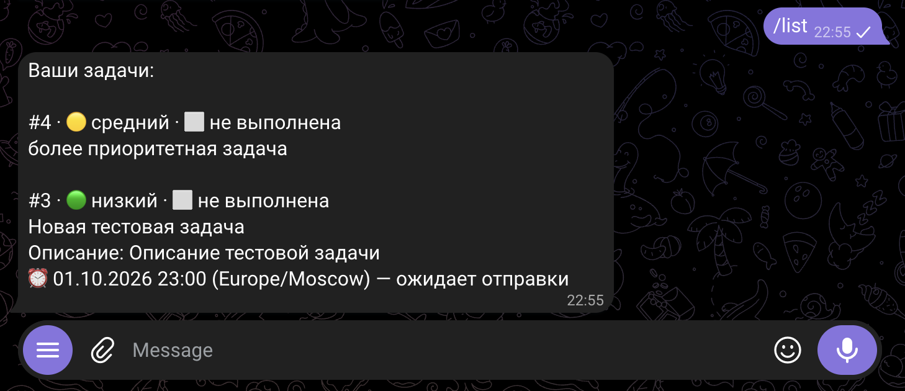
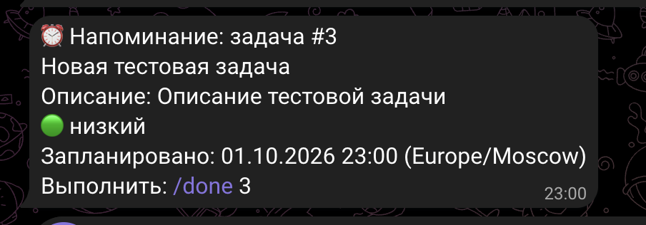
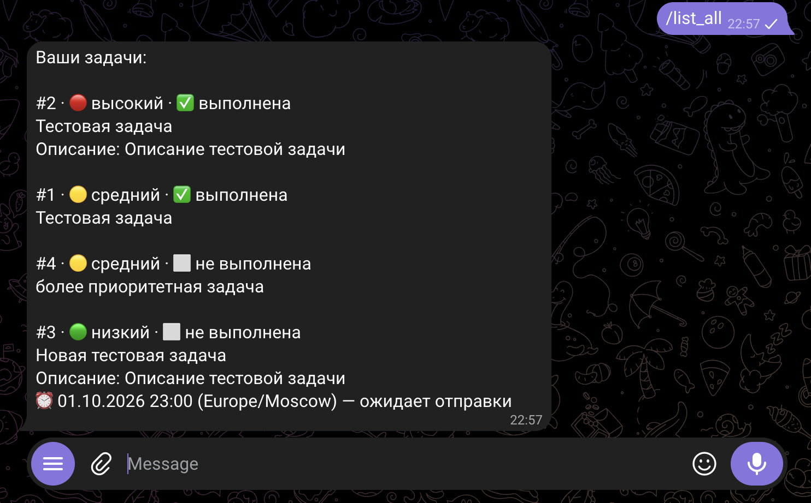

# Отчёт по лабораторной работе № 1

University: [ITMO University](https://itmo.ru/ru/)  
Faculty: [FICT](https://fict.itmo.ru)  
Course: [Vibe Coding: AI-боты для бизнеса](https://github.com/itmo-ict-faculty/vibe-coding-for-business)  
Year: 2026/2027  
Group: U4225  
Author: Agadilova Malika  
Lab: Lab1  
Date of create: 29.09.2026  
Date of finished: 01.10.2026  

## 1. Описание задачи

### 1.1. Какую проблему решает бот

Бот помогает вести личный список дел непосредственно в Telegram. Пользователь может
создать задачу с названием и необязательным описанием, выбрать её приоритет, установить
напоминание, посмотреть активные или все задачи, отметить задачу выполненной и удалить её.

Такой инструмент решает проблему разрозненных записей и забытых дел. Для работы не нужно
устанавливать отдельное приложение: достаточно открыть привычный чат. Задачи хранятся
в SQLite и не пропадают после перезапуска бота, а данные разных пользователей разделены.

### 1.2. Почему выбрали именно эту задачу

Ассистент для задач имеет понятную практическую ценность как для личной организации,
так и для небольших рабочих процессов. На его примере можно проверить основные
возможности Telegram-бота: диалог с пользователем, команды, кнопки, хранение данных,
валидацию ввода и запланированные уведомления. Задача достаточно содержательная для
лабораторной работы и при этом не требует внешнего платного API.

## 2. Промпт для LLM

### 2.1. Исходный промпт

В исходном промпте была поставлена задача создать на Python бота — ассистента для дел.
Он должен был принимать задачи текстом, назначать им один из трёх приоритетов,
показывать списки, отмечать выполнение, удалять задачи и отправлять напоминания.
Для хранения требовалась SQLite, для работы с Telegram — `python-telegram-bot`,
а настройки и токен должны были загружаться из `.env`.

Ключевая часть исходной формулировки:

```text
Создай Telegram-бота — персонального ассистента для задач — на Python
с использованием библиотеки python-telegram-bot.

Бот должен:
- принимать обычное сообщение или /add <текст задачи>;
- поддерживать высокий, средний и низкий приоритеты;
- показывать активные задачи через /list и все задачи через /list all;
- выполнять /done <ID>, /delete <ID> и команды напоминаний;
- хранить данные каждого пользователя в SQLite;
- восстанавливать напоминания после перезапуска;
- использовать .env и обрабатывать ошибки.

Создай bot.py, requirements.txt, README.md, .env.example и .gitignore.
```

Полная неизменённая версия исходного промпта находится в
[prompts/v001.md](prompts/v001.md).

### 2.2. Итерации и улучшения

После первой реализации требования были уточнены:

1. К задаче добавлено необязательное описание.
2. Команда `/add` без параметров стала запускать пошаговый диалог:
   название → описание → приоритет → напоминание.
3. Для необязательных шагов добавлена кнопка «Пропустить», для приоритета — три кнопки.
4. Добавлена `/cancel`, которая отменяет незавершённое создание.
5. `/list all` заменена на `/list_all`, а отмена напоминания перенесена в
   `/remind_off <id>`.
6. В справке числовой пример ID заменён на `<id>`.
7. Для пошагового ввода добавлен короткий формат даты `ДД.ММ ЧЧ:ММ` с текущим годом.
8. Реализована автоматическая миграция старой базы: существующие задачи получают
   пустое описание без изменения ID, статуса или напоминания.
9. Расширены тесты диалога, команд, дат, разделения пользователей и миграции базы.

Версии промпта хранятся отдельно, поэтому историю требований можно восстановить:
[v001](prompts/v001.md) → [v002](prompts/v002.md).

### 2.3. Финальный промпт

Финальная версия потребовала создать или обновить Telegram-бота с такими условиями:

```text
Создай или обнови Telegram-бота — персонального ассистента для задач —
на Python с использованием python-telegram-bot.

Задача содержит обязательное название и необязательное описание.
/add без параметров запускает диалог:
1. «Введите название задачи»;
2. «Введите описание» с кнопкой «Пропустить»;
3. «Укажите приоритет» с кнопками высокий/средний/низкий;
4. «Установить напоминание» в формате ДД.ММ ЧЧ:ММ
   с возможностью пропустить шаг.

Используй команды /list, /list_all, /priority <id>, /done <id>,
/delete <id>, /remind <id> ДД.ММ ЧЧ:ММ, /remind_off <id> и /cancel.
Показывай описание в списках и напоминаниях. Храни задачи в SQLite,
разделяй данные пользователей и мигрируй старую базу без потери данных.
Используй JobQueue, .env, обработку ошибок и русскоязычные ответы.
Проверь реализацию на Python 3.14 автоматическими тестами.
```

Полный финальный промпт со всеми граничными случаями и требованиями к проверкам
сохранён в [prompts/v002.md](prompts/v002.md). Файл
[prompts/README.md](prompts/README.md) содержит историю версий.

## 3. Стек технологий

### 3.1. Какие библиотеки использовались

| Технология | Версия | Назначение |
| --- | ---: | --- |
| Python | 3.14.7 | Язык реализации |
| python-telegram-bot | 22.8 | Команды, сообщения, клавиатуры и long polling |
| JobQueue / APScheduler | 3.11.3 | Периодическая проверка и отправка напоминаний |
| SQLite | 3.50.4 | Локальное постоянное хранение задач |
| python-dotenv | 1.2.3 | Загрузка токена и настроек из `.env` |
| tzdata | 2026.4 | База часовых поясов для `zoneinfo` |
| httpx | 0.28.1 | Сетевой клиент Telegram-библиотеки |
| unittest | стандартная библиотека | Автоматические проверки без реального Telegram API |

### 3.2. Почему выбрали именно их

`python-telegram-bot` предоставляет асинхронный интерфейс Telegram Bot API,
готовую обработку команд, кнопок и long polling. Встроенная интеграция JobQueue
подходит для небольшого локального бота с напоминаниями.

SQLite не требует отдельного сервера, сохраняет данные в одном файле и подходит
для учебного проекта. `python-dotenv` отделяет секретный токен от исходного кода,
а `zoneinfo` вместе с `tzdata` обеспечивает корректную работу с часовым поясом.
Стандартный `unittest` позволил проверить бизнес-логику и диспетчер сообщений без
публикации токена и без запросов к реальному Telegram API.

## 4. Скриншоты и видео

### 4.1. Скриншоты работы бота

#### Скриншот 1. Запуск `/start`

> 

#### Скриншот 2. Пошаговое создание задачи и кнопки

> 

#### Скриншот 3. Список задач с описанием и приоритетами

> 

#### Скриншот 4. Полученное напоминание

> 

#### Скриншот 5. Выполненные задачи в `/list_all`

> 

### 4.2. Видео-демо

[Видео](https://drive.google.com/file/d/19jjT6eo61DuGxPs2VN1_kwdetGujTcqI/view?usp=drivesdk)

## 5. Трудности и решения

### 5.1. С какими проблемами столкнулись

- Изначально системный Python имел версию 3.9.6, которая не подходила актуальной
  версии `python-telegram-bot`.
- Напоминания должны сохраняться после перезапуска, хотя очередь заданий находится
  в памяти процесса.
- Переход к задачам с описанием требовал изменить существующую базу без потери данных.
- Пошаговый `/add` должен был хранить независимые черновики нескольких пользователей,
  корректно переживать неверный ввод и не создавать частично заполненные задачи.
- Формат `ДД.ММ ЧЧ:ММ` не содержит года и может обозначать уже прошедшую дату.
- Реальный токен нельзя использовать в автотестах или публиковать в репозитории.

### 5.2. Как их решили

- Установили Python 3.14.7 и пересоздали виртуальное окружение с зафиксированными
  зависимостями; `pip check` не обнаружил конфликтов.
- Время напоминания и состояние доставки сохраняются в SQLite. JobQueue периодически
  выбирает просроченные записи, поэтому после перезапуска пропущенное напоминание
  отправляется с отметкой о задержке.
- При запуске проверяется схема таблицы. Если столбца `description` нет, выполняется
  безопасный `ALTER TABLE` со значением по умолчанию; повторная миграция ничего не меняет.
- Черновики хранятся отдельно по паре `user_id` и `chat_id`, а запись в SQLite
  выполняется одной операцией после последнего шага. Ошибка ввода оставляет текущий шаг.
- Короткая дата относится к текущему году в настроенном часовом поясе. Прошедшая дата
  отклоняется с подсказкой; при необходимости можно указать год полностью.
- Telegram API в тестах заменяется локальным объектом. Проверяются диспетчер команд,
  клавиатуры и JobQueue, при этом сетевые запросы и настоящий токен не используются.

По результатам локальной проверки на Python 3.14.7 прошли 36 автоматических тестов,
а `pip check` подтвердил совместимость зависимостей. Доставку через настоящий Telegram
нужно подтвердить вручную при подготовке скриншотов и видео.

## 6. Выводы

### 6.1. Что получилось хорошо

Получился работающий прототип ассистента с понятным русскоязычным диалогом,
описаниями, приоритетами, списками и напоминаниями. Данные сохраняются между запусками,
задачи разных пользователей изолированы, старую базу можно обновить без потерь.
История промптов сохранена отдельными версиями, поэтому видна эволюция требований.

### 6.2. Что можно улучшить

В дальнейшем можно добавить редактирование названия и описания, повторяющиеся
напоминания, категории, поиск, кнопки управления рядом с каждой задачей и индивидуальный
часовой пояс для каждого пользователя. Для постоянной работы бота его можно разместить
на сервере и добавить резервное копирование базы. Также полезно провести нагрузочное
тестирование и настроить автоматический запуск после перезагрузки сервера.

### 6.3. Чему научились

В ходе работы были освоены формулирование подробного промпта, итеративное уточнение
требований и проверка результата LLM. Практически изучены регистрация Telegram-бота,
обработка команд и состояний диалога, хранение данных в SQLite, работа с переменными
окружения, часовыми поясами и очередью напоминаний. Отдельное внимание уделено
безопасному хранению токена, миграции данных и автоматическому тестированию.
