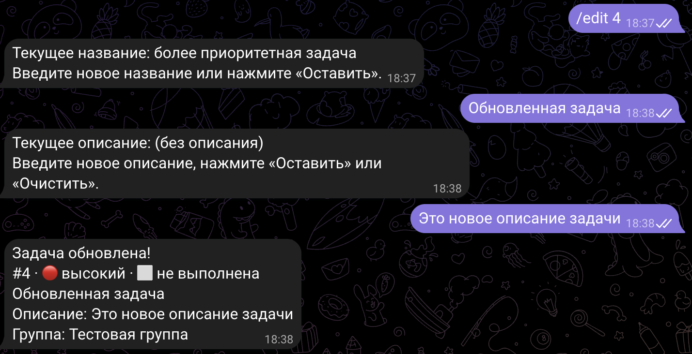
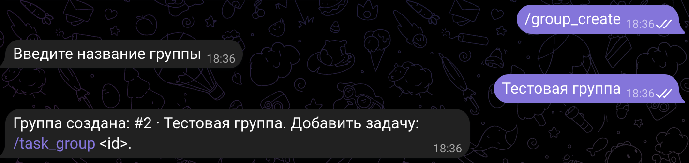
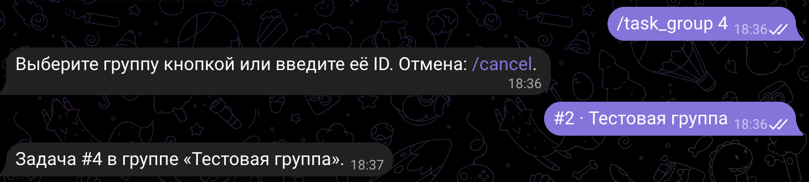

# Отчёт по лабораторной работе № 2

## «Подключение бота к данным»

University: [ITMO University](https://itmo.ru/ru/)  
Faculty: [FICT](https://fict.itmo.ru)  
Course: [Vibe Coding: AI-боты для бизнеса](https://github.com/itmo-ict-faculty/vibe-coding-for-business)  
Year: 2026/2027  
Group: U4225  
Author: Agadilova Malika  
Lab: Lab2  
Date of create: 04.10.2026  
Date of finished: 04.10.2026

Цель работы — расширить Telegram-бота интеграцией с данными и научиться формулировать
требования к их хранению, поиску и обработке для генерации кода с помощью LLM.

## 1. Описание интеграции

### 1.1. Выбранный источник данных

Выбран вариант «Простая база данных» — SQLite. В первой лабораторной работе уже был
создан Telegram-бот — персональный ассистент для задач. Он сохранял название,
описание, приоритет, статус выполнения и параметры напоминания в SQLite.

Во второй лабораторной работа с этой базой расширена: реализованы поиск по части
названия или описания, редактирование задач и объединение задач в личные группы.
Теперь пользователь может находить нужные записи, исправлять их и разделять дела,
например, на «Учёба», «Работа» и «Дом», не выходя из Telegram.

История переписки не сохраняется в базе бота: по согласованным требованиям для её
просмотра используется сам чат Telegram. Отдельные профили пользователей и команда
`/week` также не вошли в выбранный набор функций. Персональные данные задач и групп
связаны с владельцем через Telegram `user_id`.

### 1.2. Почему выбрана SQLite

SQLite уже использовалась в проекте, поэтому не потребовались новый сервер, внешний
сервис или дополнительные зависимости. Данные находятся в одном локальном файле,
сохраняются после перезапуска и доступны через встроенный модуль Python `sqlite3`.

Для учебного ассистента этого достаточно: можно изучить связанные таблицы,
выборки, изменение записей, ограничения уникальности, миграции и транзакции.
Реальная база по умолчанию создаётся в `lab1/data/tasks.sqlite3` и не включается в Git.

### 1.3. Структура данных

Таблица `tasks`:

| Поле | Тип | Назначение |
| --- | --- | --- |
| `id` | INTEGER | Уникальный ID задачи |
| `user_id`, `chat_id` | INTEGER | Владелец задачи и чат для доставки напоминания |
| `text` | TEXT | Обязательное название задачи |
| `description` | TEXT | Необязательное описание; по умолчанию пустая строка |
| `priority` | INTEGER | 0 — высокий, 1 — средний, 2 — низкий |
| `done` | INTEGER | 0 — активная задача, 1 — выполненная |
| `created_at` | REAL | Дата создания |
| `remind_at` | REAL или NULL | Время напоминания |
| `reminder_state` | TEXT | Состояние: `none`, `pending`, `sent`, `failed` |
| `next_attempt_at`, `sent_at` | REAL или NULL | Следующая попытка и время успешной отправки |
| `group_id` | INTEGER или NULL | Ссылка на группу; NULL означает отсутствие группы |

Новая таблица `task_groups`:

| Поле | Тип | Назначение |
| --- | --- | --- |
| `id` | INTEGER | Уникальный ID группы |
| `user_id` | INTEGER | Владелец группы |
| `name` | TEXT | Название для отображения |
| `name_key` | TEXT | Название после `casefold()` для проверки уникальности |
| `created_at` | REAL | Дата создания группы |

Одна группа может содержать несколько задач. Задача принадлежит одной группе либо
находится без группы. Поле `tasks.group_id` — внешний ключ с `ON DELETE SET NULL`.
Ограничение `UNIQUE(user_id, name_key)` запрещает одинаковые названия групп у одного
владельца без учёта регистра, но позволяет разным пользователям иметь группы «Учёба».

Добавлен индекс по `tasks(user_id, group_id)`. Даты хранятся как Unix timestamp в UTC,
а пользователю показываются в часовом поясе из `TIMEZONE`, по умолчанию `Europe/Moscow`.
Рабочая база не заполнялась демонстрационными данными: тестовые записи создаются
только во временных базах автоматических тестов.

## 2. Промпт для LLM

### 2.1. Исходный промпт

Начальная постановка задачи опиралась на шаблон лабораторной: описать существующего
бота, выбранный источник данных, новые функции, структуру данных и требования.
Предполагалось расширить существующую SQLite и добавить поиск по сохранённым задачам.
На этапе обсуждения также рассматривались профили пользователей, история сообщений
и выборка за последнюю неделю, но в окончательный объём работы они не вошли.

Краткое изложение исходной идеи, а не дословная копия ранней редакции:

```text
Улучши моего Telegram-бота, добавив работу с простой базой данных SQLite.

Текущий функционал бота:
Персональные задачи, приоритеты, списки дел и напоминания с хранением в SQLite.

Новый функционал:
Поиск по сохранённым задачам и расширение работы с данными пользователя.

Данные:
Существующая таблица tasks с владельцем, текстом, описанием и датой создания.

Требования:
Простой код, обработка ошибок, комментарии, сохранение существующего функционала.

Создай обновлённый bot.py, тестовые данные и README.md.
```

По решению пользователя до первой реализации все уточнения вносились в один файл
`prompts/v001.md`. Отдельная неизменённая копия ранней редакции не сохранялась;
её полный первоначальный текст нельзя восстановить из текущего файла.

### 2.2. Итерации и улучшения

Требования уточнялись до реализации:

1. Выбран существующий источник SQLite вместо файлов и внешнего API.
2. Исключено отдельное хранение истории переписки.
3. Уточнён поиск по части названия, а не только по полному совпадению. Поиск также
   распространяется на описание и не учитывает регистр, включая кириллицу.
4. Вместо дополнительных профилей и выборки за неделю выбраны практические функции:
   редактирование названия/описания и личные группы задач.
5. Определены команды создания, просмотра, переименования и удаления групп,
   назначения задачи в группу и переноса между группами.
6. Уточнено, что удаление группы сохраняет задачи и их напоминания.
7. В `/add` добавлен необязательный выбор группы после приоритета.
8. Добавлены требования к отмене диалогов, уникальности названий, проверке владельца,
   безопасной миграции и автоматическим тестам.
9. Разделено размещение файлов: общий код и тесты — в `lab1`, материалы второй
   лабораторной — в `lab2`.

Номер промпта не повышался: первая реализация выполнена по единственному `v001`.
Последующие изменения требований должны сохраняться отдельными версиями.

### 2.3. Финальный промпт

Полный финальный промпт сохранён в [prompts/v001.md](prompts/v001.md), сведения
о версии — в [prompts/README.md](prompts/README.md). Ниже — сокращённое изложение
требований по шаблону задания:

```text
Улучши моего Telegram-бота, добавив расширенную работу с простой базой данных SQLite.

Текущий функционал бота:
Задачи с названием, описанием, приоритетом, статусом и напоминанием;
пошаговая /add, списки, команды управления, JobQueue и настройки из .env.

Новый функционал:
- /search <текст>: поиск по части названия или описания без учёта регистра.
- /edit <id>: изменение названия и описания с «Оставить» и «Очистить».
- /group_create, /groups, /group_tasks <group_id>,
  /group_rename <group_id>, /group_delete <group_id>.
- /task_group <id> и /task_ungroup <id>.
- Необязательный выбор группы при пошаговом добавлении задачи.
- Удаление группы без удаления задач и отмены напоминаний.
- /cancel отменяет любой незавершённый диалог.

Данные:
Сохрани tasks, добавь nullable group_id и таблицу task_groups.
Названия групп одного владельца уникальны без учёта регистра.
Миграция не должна менять ID, статусы и напоминания существующих задач.

Требования:
Проверяй владельца задачи и группы, используй параметризованные SQL-запросы.
Обрабатывай неверный ввод и ошибки SQLite, сохраняй шаг диалога при ошибке.
Не добавляй историю сообщений, /week, профили пользователей и новые зависимости.
Код и тесты оставь в lab1, материалы лабораторной — в lab2.

Создай:
Обновлённый bot.py, тесты с временными базами и README.md.
Запусти старые и новые тесты и pip check.
```

Ограничение «отчёт пока не создавай» в сохранённом промпте относилось к этапу
реализации. Этот отчёт подготовлен по отдельному последующему запросу пользователя;
исторический промпт не изменён и новая версия не создана.

## 3. Реализация

### 3.1. Как работает интеграция

Основная реализация находится в [lab1/bot.py](../lab1/bot.py).
`TaskStore` открывает SQLite, создаёт недостающие элементы схемы и выполняет запросы.
`TaskAssistant` обрабатывает команды, хранит состояния диалогов и форматирует ответы.

После получения команды бот определяет Telegram `user_id`, проверяет параметры
и обращается к хранилищу. Все пользовательские выборки ограничиваются владельцем.
Названия групп подставляются в задачи через `LEFT JOIN`, поэтому задачи без группы
тоже отображаются в списках. Результат сортируется по приоритету и времени создания,
а длинные ответы делятся на сообщения.

Новые команды:

| Команда | Назначение |
| --- | --- |
| `/search <текст>` | Найти свои задачи по фрагменту названия или описания |
| `/edit <id>` | Изменить название и описание пошагово |
| `/group_create` | Запросить название и создать группу |
| `/groups` | Показать группы и количество активных задач |
| `/group_tasks <group_id>` | Показать все задачи группы, включая выполненные |
| `/group_rename <group_id>` | Изменить название группы |
| `/group_delete <group_id>` | Удалить только группу |
| `/task_group <id>` | Назначить группу либо перенести задачу в другую |
| `/task_ungroup <id>` | Оставить задачу без группы |

Поиск включает выполненные задачи. `%` и `_` воспринимаются буквально, а не как
шаблоны SQL. При редактировании бот показывает текущие значения и предлагает
«Оставить», а для описания также «Очистить». Оба поля записываются только после
завершения диалога; остальные свойства задачи не меняются.

Черновики разделены по `user_id` и `chat_id`. `/cancel` отменяет незавершённые
изменения, `/start` сбрасывает диалог, команды просмотра не удаляют черновик.
В `/add` группа выбирается после приоритета; если групп нет, шаг пропускается.
Быстрое добавление обычным текстом или `/add Название` создаёт задачу без группы.

Старые функции сохранены. Напоминания продолжают выбираться из SQLite через JobQueue;
при отправке используются актуальные название, описание и название группы.

### 3.2. Ключевые фрагменты кода

Для корректного поиска по кириллице в SQLite зарегистрирована функция Python:

```python
self.connection.create_function("CASEFOLD", 1, str.casefold, deterministic=True)
```

После удаления пробелов по краям и `casefold()` запрос выполняется с параметрами:

```python
return self.connection.execute(
    self.TASK_SELECT + "WHERE t.user_id = ? "
    "AND (instr(CASEFOLD(t.text), ?) > 0 OR instr(CASEFOLD(t.description), ?) > 0) "
    "ORDER BY t.priority, t.created_at, t.id", (user_id, query, query),
).fetchall()
```

`instr` проверяет наличие подстроки. Параметры `?` отделяют пользовательский текст
от SQL-кода, а условие `t.user_id = ?` ограничивает результат владельцем.

Добавление связи с группой в существующую таблицу выполняется только при отсутствии
столбца:

```python
if "group_id" not in columns:
    self.connection.execute(
        "ALTER TABLE tasks ADD COLUMN group_id INTEGER REFERENCES task_groups(id) ON DELETE SET NULL"
    )
```

Таблица не пересоздаётся, поэтому существующие ID и данные не меняются. Старые задачи
получают NULL в новом поле. Повторный запуск не сбрасывает уже назначенные группы.

Удаление группы и снятие назначений выполняются одной транзакцией после проверки
владельца:

```python
self.get_group(group_id, user_id)
with self.connection:
    self.connection.execute(
        "UPDATE tasks SET group_id = NULL WHERE group_id = ? AND user_id = ?", (group_id, user_id),
    )
    self.connection.execute("DELETE FROM task_groups WHERE id = ? AND user_id = ?", (group_id, user_id))
```

Если операция завершается ошибкой, изменения откатываются. Поля напоминания,
название, описание и статус задачи при удалении группы не изменяются.

### 3.3. Используемые библиотеки

| Технология | Версия | Назначение |
| --- | --- | --- |
| Python | 3.14.7 | Язык реализации |
| SQLite / `sqlite3` | SQLite 3.50.4, модуль стандартной библиотеки | Постоянное хранение и SQL-запросы |
| `python-telegram-bot` | 22.8 | Команды, диспетчер сообщений и клавиатуры |
| JobQueue / APScheduler | APScheduler 3.11.3 | Проверка и доставка напоминаний |
| `python-dotenv` | 1.2.3 | Загрузка конфигурации из `.env` |
| `zoneinfo` / `tzdata` | `tzdata` 2026.4 | Часовые пояса |
| `unittest`, `unittest.mock`, `tempfile` | Стандартная библиотека | Автотесты, подмена Telegram API и временные базы |

Новые сторонние зависимости не добавлялись. Использованы существующее окружение
и стандартный `sqlite3`, без ORM и внешних API данных. LLM применялась при подготовке
требований и реализации; во время работы бота обращения к LLM не требуются.

## 4. Тестирование

### 4.1. Автоматические проверки

Из папки `lab1` выполнены:

```bash
.venv/bin/python -m unittest discover -s tests -q
.venv/bin/python -m pip check
```

Результат повторной проверки 04.10.2026 на Python 3.14.7:

```text
Ran 55 tests
OK

No broken requirements found.
```

Проверки находятся в [tests/test_bot.py](../lab1/tests/test_bot.py) и
[tests/test_lab2.py](../lab1/tests/test_lab2.py). Второй файл добавляет 19 тестов;
проверки диспетчера и меню из первого файла дополнены новыми командами.

| Проверяемый сценарий | Результат |
| --- | --- |
| Поиск по части названия и описания, регистр кириллицы | Пройден |
| Пустой запрос, отсутствие совпадений, буквальные `%` и `_` | Пройден |
| Сортировка результатов и разделение длинного ответа | Пройден |
| Изменение названия/описания, «Оставить», «Очистить», отмена | Пройден |
| Сохранение остальных полей при редактировании | Пройден |
| Создание, переименование, удаление группы и дубли названий | Пройден |
| Назначение, перенос, снятие группы и выбор группы в `/add` | Пройден |
| Сохранение задач и напоминаний после удаления группы | Пройден |
| Чужие ID, подделанные кнопки и изоляция двух пользователей | Пройден |
| Миграция старой базы и сохранение данных после перезапуска | Пройден |
| Ошибки SQLite, повтор шага и откат удаления группы | Пройден |
| Актуальные тексты и название группы в напоминании | Пройден |
| Диспетчер PTB, меню команд и JobQueue с локальной подменой API | Пройден |

Тесты используют временные базы и не обращаются к настоящему Telegram API.
Рабочая база и настоящий токен не использовались. Проверки подтверждают логику,
но не заменяют ручную проверку интерфейса и доставки сообщений в Telegram.

### 4.2. Примеры запросов и ответов

Ниже — демонстрационные сценарии и ожидаемые ответы, а не запись проведённого
сеанса Telegram. Числовые ID приведены для примера; при проверке используются
реальные ID, выданные ботом.

Создание группы:

```text
Пользователь: /group_create
Бот: Введите название группы
Пользователь: Учёба
Бот: Группа создана: #1 · Учёба. Добавить задачу: /task_group <id>.
```

Если задача #1 имеет название «Купить продукты» и описание «Молоко и хлеб»,
поиск `/search ПРОД` находит её без ввода полного названия:

```text
Пользователь: /search ПРОД
Бот:
Найденные задачи:

#1 · 🟡 средний · ⬜ не выполнена
Купить продукты
Описание: Молоко и хлеб
Группа: Без группы
Создана: [дата создания] (Europe/Moscow)
```

Запрос `/search хлеб` находит ту же задачу по описанию. Поиск несуществующего
фрагмента возвращает «Задачи не найдены. Попробуйте другую часть названия или описания.»

Редактирование и назначение группы:

```text
Пользователь: /edit 1
Бот: Текущее название: Купить продукты
     Введите новое название или нажмите «Оставить».
Пользователь: Купить материалы для лабораторной
Бот: Текущее описание: Молоко и хлеб
     Введите новое описание, нажмите «Оставить» или «Очистить».
Пользователь: Очистить
Бот: Задача обновлена! [карточка задачи]

Пользователь: /task_group 1
Бот: Выберите группу кнопкой или введите её ID. Отмена: /cancel.
Пользователь: #1 · Учёба
Бот: Задача #1 в группе «Учёба».

Пользователь: /groups
Бот: Ваши группы:
     #1 · Учёба — активных задач: 1
```

После `/group_delete 1` бот сообщает, что группа удалена, а задачи сохранены без
группы и напоминания не изменены. `/list_all` продолжает показывать задачу.
При попытке обратиться к группе другого владельца возвращается «Группа не найдена».

### 4.3. Скриншоты работы

1. **Поиск по части названия и описания.**
   
2. **Редактирование задачи.**
   
3. **Создание групп и список `/groups`.**
   
4. **Назначение и перенос задачи.**
   

### 4.4. Видео-демо

[Видео](https://drive.google.com/file/d/1s3cb9MrRm_tDEOlQSlAMlJ_Ds6_cxpU3/view?usp=sharing)

## 5. Трудности и решения

### 5.1. Поиск по кириллице и части названия

Обычные средства сравнения строк SQLite не обеспечивают нужное поведение для
регистронезависимого поиска по кириллице. Решение — зарегистрировать `CASEFOLD`
на основе Python `str.casefold()` и использовать `instr` для подстроки.
Это также позволяет искать буквальные `%` и `_`, не трактуя их как шаблоны `LIKE`.

### 5.2. Совместимость с базой первой лабораторной

Нельзя было пересоздать таблицу и потерять уже сохранённые задачи. Схема проверяется
через `PRAGMA table_info`; недостающие столбцы добавляются с помощью `ALTER TABLE`,
а таблица групп — через `CREATE TABLE IF NOT EXISTS`. Миграция проверена на временной
базе старого формата, включая повторное открытие и сохранение назначения группы.

### 5.3. Редактирование без частичных изменений

После ввода нового названия пользователь может отменить диалог или ошибиться при
вводе описания. Новые значения сначала находятся в черновике; обновление двух полей
выполняется только в конце. Ошибка SQLite не удаляет черновик и позволяет повторить
последний шаг. Напоминание при этом не создаётся заново и использует текущие данные.

### 5.4. Удаление группы и сохранность задач

Удаление группы не должно удалять связанные задачи. Снятие назначений и удаление
группы объединены в одну транзакцию. Тест с искусственным запретом удаления
подтверждает откат: при ошибке сохраняются и группа, и ссылки задач на неё.

### 5.5. Защита данных разных пользователей

Одного ID недостаточно для безопасного изменения записи. При чтении и изменении
проверяется `user_id` задачи и группы. ID повторно проверяется и при ответе на кнопку,
поэтому поддельный текст кнопки не позволяет назначить чужую группу. Изоляция
проверена в автотестах с двумя пользователями.

### 5.6. Проверки без настоящего Telegram API

Для воспроизводимых тестов нужны данные и ошибки, которые нельзя безопасно создавать
в рабочем чате. Использованы временные базы, `AsyncMock` и локальная подмена ответов
Telegram API. Настоящий диспетчер PTB и JobQueue проверяются без сети и реального
токена; ручные скриншоты и видео должны дополнить, а не подменить эти результаты.

## 6. Выводы

### 6.1. Что получилось хорошо

Существующий ассистент расширен без замены стека: он поддерживает поиск, редактирование
и личные группы, сохраняя прежние команды и напоминания. Задачи и группы сохраняются
между запусками, миграция не удаляет старые данные, операции ограничены владельцем.
Первая версия прошла 55 автоматических тестов, зависимости совместимы.

Удалось сформулировать конкретный промпт с командами, структурой таблиц, правилами
отмены, обработки ошибок и сохранности данных. Промпт сохранён в репозитории;
изменения до первой реализации не привели к созданию лишних версий.

### 6.2. Что можно улучшить

В дальнейшем можно добавить постраничный вывод длинных списков, более удобные кнопки
управления задачами, автоматическое резервное копирование SQLite и постоянный запуск
на сервере. При росте количества задач стоит измерить скорость поиска и оценить
полнотекстовый индекс. Отдельно можно улучшить восстановление незавершённых диалогов
после перезапуска: сейчас черновики находятся в памяти процесса.

Ближайший шаг — ручная проверка обновлённого бота в Telegram, добавление скриншотов,
видео и даты завершения. На момент составления отчёта эти материалы отсутствуют,
поэтому полная демонстрационная часть лабораторной ещё не подтверждена.

### 6.3. Чему научились

Работа показала, как уточнять задачу для LLM и связывать требования с проверяемым
поведением. Были изучены связанные таблицы SQLite, поиск по подстроке, параметры
SQL-запросов, транзакции, миграция схемы и проверка владельца данных. Также освоено
разделение автоматических проверок и ручной демонстрации, чтобы выводы отчёта
соответствовали фактически выполненным действиям.
