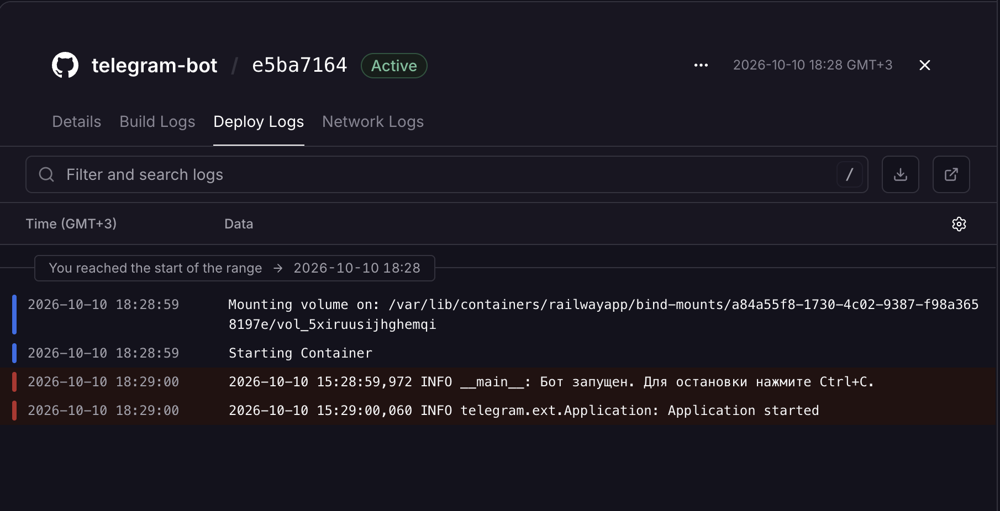
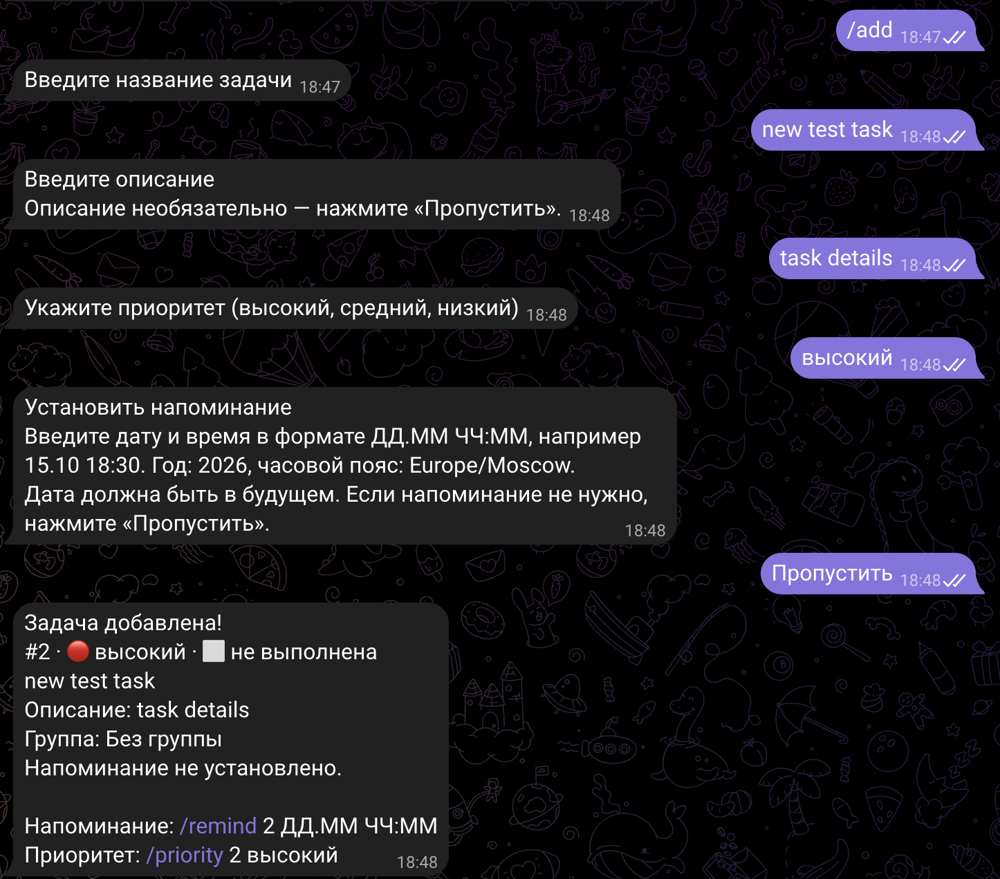
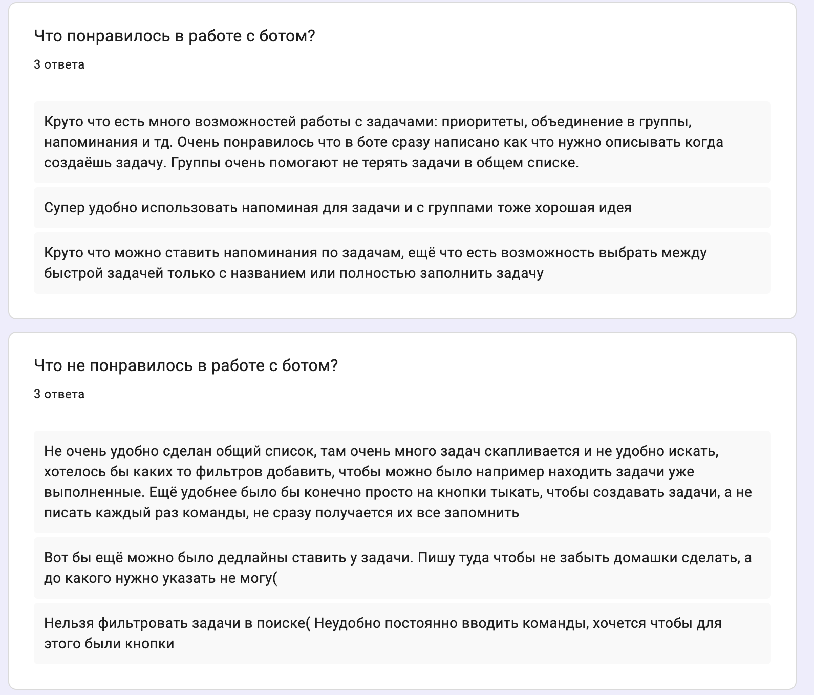
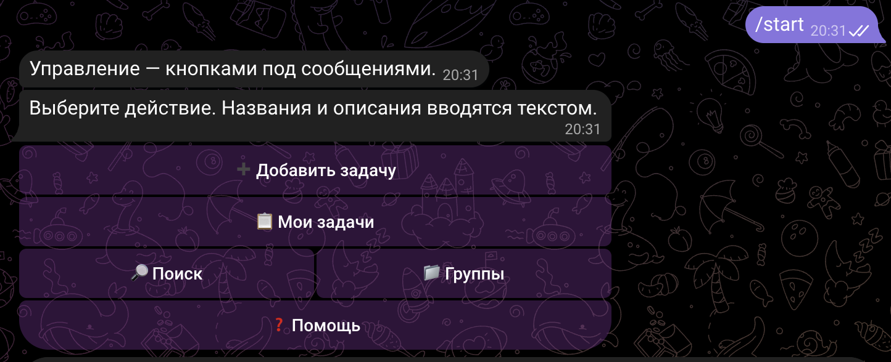
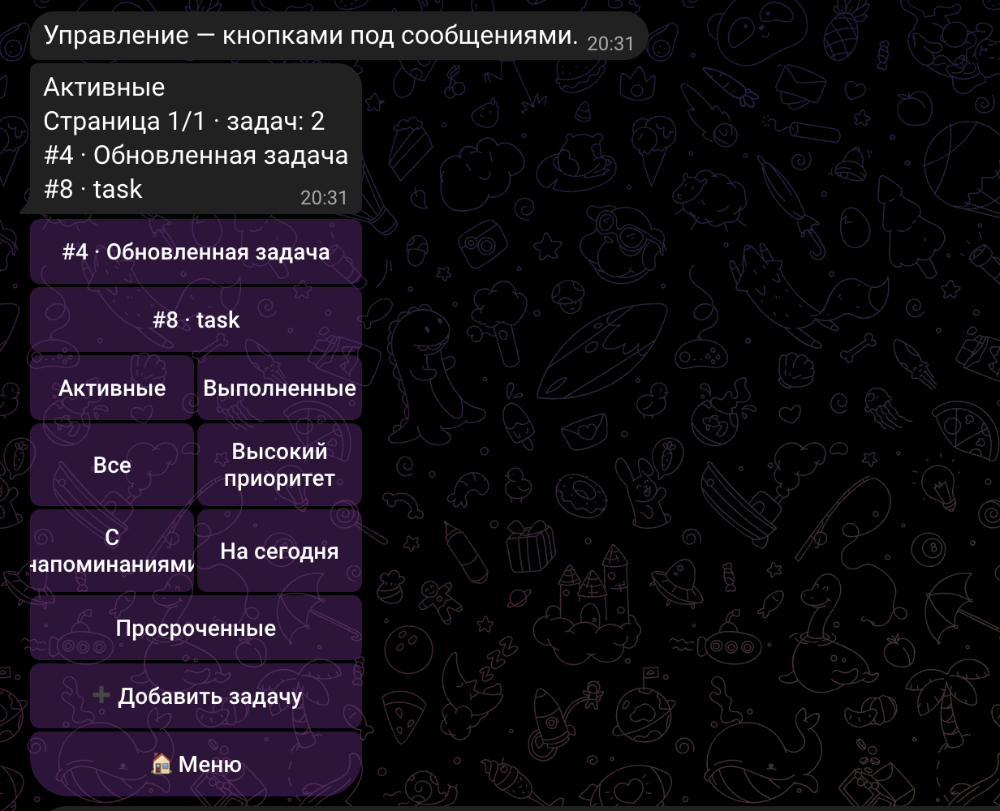
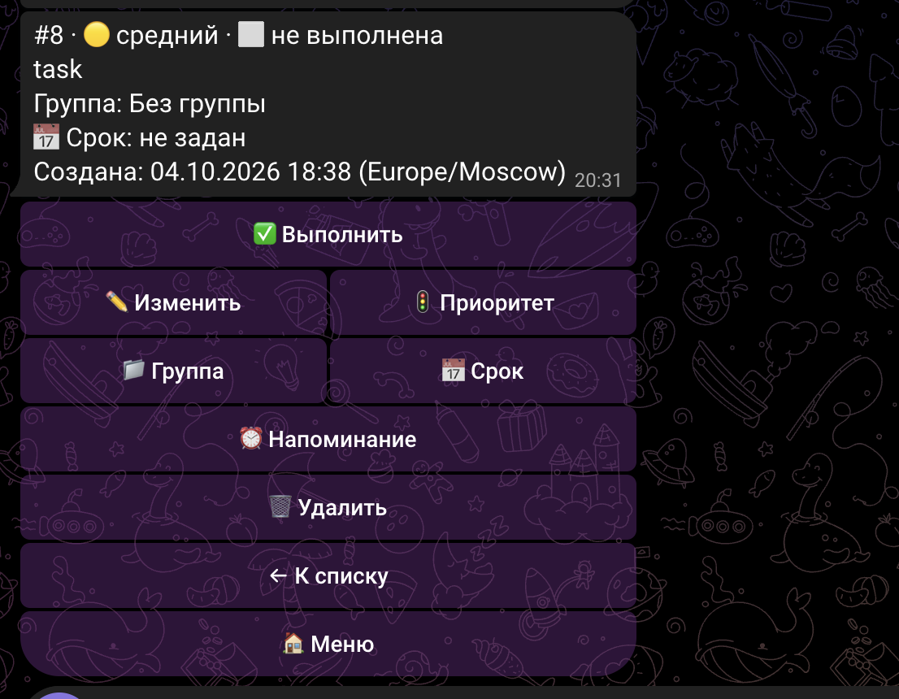
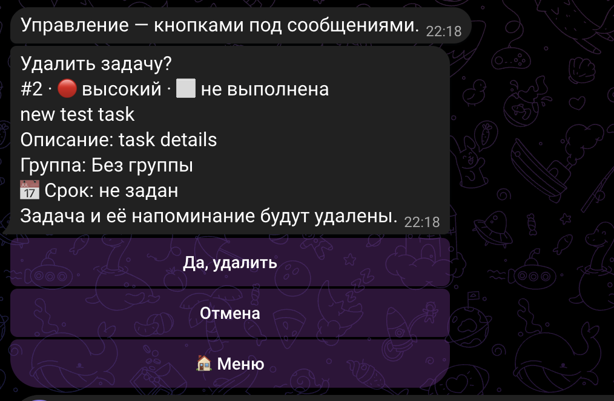
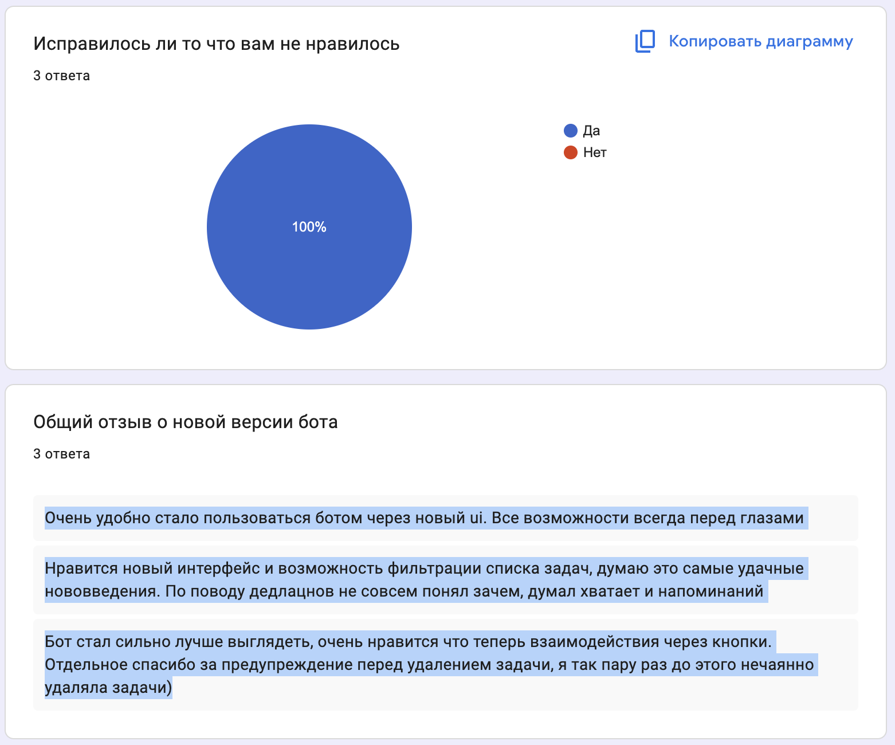

# Отчёт по лабораторной работе № 3

## «Запуск бота для реального использования»

University: [ITMO University](https://itmo.ru/ru/)  
Faculty: [FICT](https://fict.itmo.ru)  
Course: [Vibe Coding: AI-боты для бизнеса](https://github.com/itmo-ict-faculty/vibe-coding-for-business)  
Year: 2026/2027  
Group: U4225  
Author: Agadilova Malika  
Lab: Lab3  
Date of create: 10.10.2026

Цель работы — развернуть Telegram-бота для реального использования, собрать
обратную связь пользователей, улучшить приложение и проверить результат обновления.

## 1. Описание деплоя

### 1.1. Приложение и выбранный способ размещения

В предыдущих лабораторных работах был создан **Task Mini Bro** — личный
Telegram-ассистент для задач. Он поддерживает названия и описания, приоритеты,
напоминания, поиск по части названия или описания, редактирование и группы задач.
В этой работе бот размещён на **Railway**, выбран вариант «Облачный хостинг».

Бот доступен по ссылке: [@itmoftmi_ma_bot](https://t.me/itmoftmi_ma_bot).

Railway выбран для переноса существующего Python-проекта из GitHub в облако без
самостоятельного администрирования VPS. Облачный процесс не зависит от включённого
ноутбука автора, что подходит для доступа друзей к боту и отправки напоминаний.
Состояние запуска можно проверять по журналам сервиса. Стоимость и ограничения
конкретного тарифа не исследуются в этом отчёте; бесплатная постоянная работа
не заявляется.

В проекте сохранён **polling**: приложение само получает сообщения и нажатия кнопок
из Telegram. HTTP-сервер, webhook и публичный веб-домен не добавлялись.
Пользовательская точка входа — ссылка на Telegram-бота, а не URL веб-приложения.

### 1.2. Стек и размещение файлов

- Python 3.14; локальные проверки выполнены на Python 3.14.7.
- `python-telegram-bot[job-queue] 22.8` — Telegram, кнопки и проверка напоминаний.
- `python-dotenv 1.2.3` — загрузка настроек для локального запуска.
- `tzdata 2026.4` и стандартный `zoneinfo` — часовые пояса.
- SQLite из стандартной библиотеки — задачи, группы и параметры напоминаний.
- GitHub и Railway/Railpack — исходный код и облачная сборка.

Код, тесты и конфигурация находятся в `lab1`; материалы лабораторной — в `lab3`.
Конкретная patch-версия Python в облаке не определяется по представленным скриншотам:
в [`.python-version`](../lab1/.python-version) зафиксирована ветка `3.14`.

## 2. Процесс деплоя

### 2.1. Подготовка и порядок развёртывания

Подготовка выполнена с помощью LLM по [промпту v001](prompts/v001.md).
Настройки и последовательность действий сохранены в [инструкции Railway](README.md).
Облачные действия автор выполняла самостоятельно в браузере.

1. Проверено существующее окружение, зависимости, обработка ошибок и тесты.
   Токен, `.env`, базы SQLite, журналы, виртуальное окружение и резервные копии
   исключены из Git; секреты и локальные данные также исключены из контекста сборки.
2. Подготовлена приватная резервная копия локальной SQLite через Backup API.
   В документации подготовки зафиксирован успешный `PRAGMA integrity_check`.
   Копия не включена в отчёт и репозиторий, поскольку содержит пользовательские данные.
3. В `lab1` добавлены `.python-version`, `.dockerignore` и `railpack.json`.
   Команда запуска в [конфигурации](../lab1/railpack.json) — `python -u bot.py`.
   Зависимости зафиксированы в [requirements.txt](../lab1/requirements.txt).
4. В Railway подключён GitHub-репозиторий с ботом. Для сборки проекта подготовлен
   Root Directory `/lab1`, так как Python-код находится не в корне репозитория.
5. Для сервиса предусмотрены переменные `TELEGRAM_BOT_TOKEN`, `TIMEZONE` и
   `DATABASE_PATH`. Реальный токен вводится в Variables и не публикуется.
6. Для постоянной SQLite предусмотрен Volume и путь базы внутри него. Проектная
   конфигурация — Volume `/data`, `DATABASE_PATH=/data/tasks.sqlite3`,
   `TIMEZONE=Europe/Moscow`, один экземпляр polling-бота.
7. После запуска проверены статус деплоя и журналы, затем работа бота в Telegram.
   Перед использованием того же токена локально облачную копию необходимо остановить,
   а перед возвращением в Railway — остановить локальную.
8. После доработок новая версия снова развёрнута в Railway. Обновление подтверждено
   автором и повторными отзывами пользователей; отдельный скриншот второго деплоя
   не предоставлялся.

Volume предназначен для сохранения данных между деплоями; SQLite не должна находиться
только во временной файловой системе контейнера.
[Документация Railway о Volume](https://docs.railway.com/volumes).

На скриншоте первого деплоя видны статус **Active**, подключение Volume, запуск
контейнера и сообщения об успешном старте приложения. Этот скриншот подтверждает
первый запуск, но не является графиком длительной стабильности или подтверждением
всех значений Variables.



*Рисунок 1 — первый запуск сервиса в Railway, 10.10.2026.*

### 2.2. Особенности и решения

При подготовке потребовалось учесть несколько особенностей существующего проекта:

- **Код в подпапке.** В качестве корня сборки предусмотрен `/lab1`, чтобы сборщик
  находил зависимости и `bot.py`.
- **Сохранение SQLite.** База вынесена в конфигурацию постоянного диска, а не включена
  в образ приложения. При обновлении выполняется миграция с добавлением полей,
  без удаления прежних задач и групп.
- **Локальная и облачная копии.** Для тестирования нового интерфейса использовалось
  переключение между окружениями. Одновременный polling с одним токеном не нужен;
  фактический сбой `Conflict` в представленных материалах не зафиксирован.
- **Отличие проекта от примеров задания.** Сохранены реальные зависимости Python 3.14,
  существующий polling и команда в `railpack.json`, а не скопированы примерные версии
  библиотек и webhook-настройка. Отдельный `Procfile` в проект не добавлялся.

Это описывает принятые решения, а не вымышленные аварии при деплое. Скриншотов
ошибок облачной сборки в материалах нет.

### 2.3. Проверки и сохранность данных

Перед формированием отчёта повторно выполнены проверки из `lab1`:

```bash
PYTHONDONTWRITEBYTECODE=1 .venv/bin/python -W error::ResourceWarning -m unittest discover -s tests -q
.venv/bin/python -m pip --no-cache-dir check
```

Результат: **104 теста прошли**, конфликтов зависимостей нет, Python — **3.14.7**.
Тесты работают с временными базами и подменой Telegram API, без настоящего токена.
Они проверяют хранение, миграции, команды, кнопки, фильтры, сроки, напоминания,
права владельцев, повторные нажатия и ошибки SQLite/сети.

Отдельно автор проверила сохранность в Railway: отключила деплой, обновила бота
и включила сервис обратно. После этого её ранее созданные задачи сохранились.
Это результат ручной проверки автора, а не вывод из локальных автотестов.

Пользовательское тестирование длилось **один день**. Скриншотов графиков CPU/памяти
и отдельного экрана настроек Volume в предоставленных материалах нет.
Поэтому многодневная безотказная работа и отсутствие роста памяти не заявляются.
Для полной проверки стабильности по заданию наблюдение стоит продолжить несколько
дней, сохранив метрики и журналы. Сценарии описаны в [чек-листе](manual_checks.md).

## 3. Сбор фидбека

### 3.1. Участники и способ сбора

Бота тестировали **три друга** в течение одного дня. Отзывы собирались через
онлайн-опрос в два этапа: до доработок и после обновления. Для работы с личными
задачами использовался чат с ботом; группы задач внутри приложения не являются
общими списками участников Telegram-группы.

На первом этапе участники отвечали, что понравилось и что не понравилось в работе
бота. После обновления — исправились ли прежние неудобства и как они оценивают
новую версию. Представленные скриншоты содержат по три ответа на каждый вопрос,
без имён и других идентификаторов участников.

### 3.2. Первоначальный опыт использования

До обновления пользователи создавали задачи командами и получали текстовые подсказки.
Доступны были быстрое добавление только названия и полный пошаговый ввод.
Пример создания задачи показан ниже; это **старый интерфейс**, а не новая кнопочная форма.
Общий экран команд сохранён отдельно: [интерфейс до обновления](report_assets/screenshots/works_bot.png).



*Рисунок 2 — название, описание, приоритет и пропуск напоминания в прежней версии.*

Исходный опрос показывает положительные оценки напоминаний, групп и вариантов
создания задач. Основные замечания — сложность запоминания команд, отсутствие
фильтрации большого списка и необходимость отдельного срока выполнения.



*Рисунок 3 — первоначальные ответы о достоинствах и неудобствах бота.*

### 3.3. Статистика использования и опросов

| Показатель | Фактический результат |
| --- | --- |
| Участники пользовательского тестирования | 3 друга |
| Длительность тестирования | 1 день, по сообщению автора |
| Ответы на каждый первоначальный вопрос | 3 |
| Ответы на каждый вопрос после обновления | 3 |
| Ответ «Да» на вопрос об исправлении неудобств | 3 из 3 — 100% этой небольшой выборки |
| Задачи, созданные автором при тестировании | Около 7, по её оценке |
| Общее число задач всех участников и число групп | Не зафиксированы |

Около семи задач — оценка активности **автора**, а не всех пользователей.
Из ID задач на скриншотах нельзя вывести число созданных задач: ID могут иметь пропуски.
Счётчики обращений и выгрузка полной пользовательской базы не использовались.
Результаты трёх человек дают качественную обратную связь, но не заменяют исследование
большой аудитории.

## 4. Анализ фидбека

### 4.1. Что понравилось

Из первоначальных отзывов выделены четыре полезных свойства приложения:

1. Напоминания помогают не забывать задачи.
2. Можно быстро создать задачу с одним названием либо заполнить её подробнее.
3. Группы помогают разделять дела и не терять их в общем списке.
4. Приоритеты позволяют выделять важные задачи.

Положительно оценены и текстовые подсказки во время создания. Поэтому при обновлении
базовые функции и пошаговые пояснения сохранены; быстрый способ `/add Название`
остался альтернативой полной кнопочной форме.

### 4.2. Проблемы и приоритеты улучшений

В скриншоте первоначального опроса два из трёх ответов о недостатках упоминают
фильтры и команды, один — дедлайн. Дополнительно автор передала замечания о
долгом ручном вводе даты напоминания и случайном удалении. Эти два замечания
не видны в исходном скриншоте, но проблема удаления также упомянута в повторном отзыве.

Предложения LLM были сопоставлены с реальным фидбэком и использованы для доработки.
Приоритеты ниже — результат анализа, а не отдельное голосование пользователей.

| Проблема | Приоритет | Изменение |
| --- | --- | --- |
| Необходимо постоянно вводить и помнить команды | Высокий: влияет на большинство действий | Главное меню, карточки и формы на кнопках |
| В длинном списке и поиске сложно выделить нужные задачи | Высокий: повторяется в исходных отзывах | Фильтры и постраничные списки |
| Случайное удаление заставляет вводить задачу заново | Высокий: риск потери данных | Подтверждение удаления с возможностью отмены |
| Неудобно каждый раз полностью вводить дату уведомления | Средний: ускорение частого действия | Предустановленные варианты напоминания |
| Нельзя указать, до какого момента выполнить задачу | Средний: отдельный сценарий, например домашнее задание | Независимый дедлайн с необязательным временем |

## 5. Улучшения

### 5.1. Реализованные изменения

Согласованные требования сохранены в [промпте v002](prompts/v002.md), подробные
правила — в [плане доработок](improvements_plan.md). История промптов не переписывалась:
исходный `v002` был сформулирован на этапе предложений ассистента, а позднее автор
подтвердила соответствие пяти улучшений отзывам друзей.

**Кнопочный интерфейс.** Главное меню показывает добавление задачи, список, поиск,
группы и помощь. Карточка позволяет выполнить, отредактировать или удалить задачу,
изменить приоритет, группу, срок и напоминание без обязательного ввода команды или ID.
Текст нужен для свободных полей. Есть возврат, отмена и подтверждение сохранения.
Обычный текст вне активной формы больше не создаёт задачу случайно.



*Рисунок 4 — основные действия доступны кнопками под сообщением.*

**Фильтры и страницы.** Добавлены активные, выполненные, все, высокий приоритет,
с напоминаниями, на сегодня и просроченные. Фильтры применяются и к результатам
поиска, а также внутри выбранной группы. Списки разбиты по пять элементов;
возврат из карточки сохраняет контекст списка.



*Рисунок 5 — фильтры новой версии; на данном экране выбраны активные задачи.*

**Быстрые напоминания.** Вместо обязательного полного ввода даты можно выбрать
«Через 15 минут», «Через час» или «Завтра в 09:00». Ручная дата и отключение
сохранены. При подходящем будущем сроке предлагается «За час до срока», но
уведомление не включается автоматически. Перед сохранением показано точное время.

**Дедлайны.** Срок выполнения хранится отдельно от времени уведомления. Можно
выбрать дату без времени — до конца выбранного дня — или точные дату и время.
Изменение дедлайна не переносит напоминание; отключение уведомления не удаляет срок.
Это позволяет отличить «сделать домашнее задание до пятницы» от «напомнить о нём
в четверг вечером». Старая база получает новые поля без сброса существующих данных.



*Рисунок 6 — отдельные кнопки срока и напоминания. У показанной задачи срок ещё не задан.*

**Безопасное удаление.** И кнопка, и команда сначала показывают задачу и предлагают
подтвердить или отменить удаление. Подтверждение связано с владельцем и актуальным
состоянием, ограничено по времени; старое или повторное нажатие не выполняет действие
заново. Удаление группы сохраняет её задачи и напоминания.



*Рисунок 7 — задачу можно сохранить, нажав «Отмена», вместо случайного удаления.*

Новая версия использует `CallbackQueryHandler` и принимает `callback_query` при polling.
Хранение и доставка остались в `bot.py`, экранный интерфейс вынесен в `buttons.py`,
обработка дат — в `task_dates.py`, общий тип ошибки — в `errors.py`.
Новых внешних зависимостей не потребовалось. Секреты и рабочая база не использовались
для локальных автоматических проверок.

### 5.2. Повторная обратная связь

После обновления собраны три ответа. На вопрос «Исправилось ли то, что вам не
нравилось» **все три участника ответили «Да»**. Это 100% ответов в опросе, а не
доказательство отсутствия всех ошибок приложения.



*Рисунок 8 — три положительных ответа об исправлении неудобств и комментарии о новой версии.*

Краткие цитаты участников, без исправления их формулировок:

> «Очень удобно стало пользоваться ботом через новый ui. Все возможности всегда перед глазами»

> «Нравится новый интерфейс и возможность фильтрации списка задач, думаю это самые удачные нововведения.»

> «Отдельное спасибо за предупреждение перед удалением задачи, я так пару раз до этого нечаянно удаляла задачи)»

Все три комментария положительно оценивают интерфейс. Один отдельно выделяет
фильтрацию, другой — защиту от случайного удаления. Таким образом, повторный опрос
поддерживает вывод об улучшении удобства управления и безопасности удаления.
Отдельной оценки быстрых напоминаний в повторных комментариях нет.

При этом один участник не понял, зачем нужны дедлайны, если есть напоминания.
Это замечание сохранено в анализе: функция реализована, но её назначение следует
объяснить понятнее. Следующее улучшение — подсказка «Срок — когда задача должна быть
готова; напоминание — когда бот должен уведомить», с примером учебной задачи.
Эта дополнительная подсказка в рамках отчёта не реализовывалась.

## 6. Выводы

### 6.1. Что получилось хорошо

Бот перенесён в Railway и использован тремя реальными участниками. Собраны отзывы
до и после обновления, выделены основные неудобства и реализованы пять соответствующих
улучшений. Наиболее явно пользователи оценили кнопочное управление, фильтры и
подтверждение удаления. Полезные исходные функции — группы, приоритеты, напоминания
и два способа создания задач — сохранены.

После остановки и обновления облачного сервиса задачи автора сохранились.
Повторная локальная проверка подтвердила прохождение всех 104 тестов и совместимость
зависимостей. Автотесты и пользовательские отзывы дают разные виды подтверждения
и не подменяют друг друга.

### 6.2. Что можно улучшить

- Яснее объяснять разницу между дедлайном и напоминанием.
- Продолжить наблюдение несколько дней и сохранить метрики памяти, CPU и журналы.
  Одного дня и скриншота запуска недостаточно для вывода о длительной стабильности.
- Собирать обезличенную статистику действий, а не оценивать использование только
  по отзывам и приблизительному числу задач автора.
- Расширить тестирование за пределы трёх друзей, включая проверку понятности новых функций.

### 6.3. Чему научились

В ходе работы освоены подготовка Python-проекта к облачной сборке, настройка запуска
и переменных окружения, использование постоянного хранилища для SQLite и проверка
сохранности данных после обновления. Также получен опыт сбора фидбэка, превращения
замечаний в требования для LLM, проверки сгенерированных изменений и повторного
опроса пользователей. Главный вывод: наличие функций не гарантирует удобство —
понятный интерфейс, защита от ошибок и объяснение назначения возможностей не менее важны.
